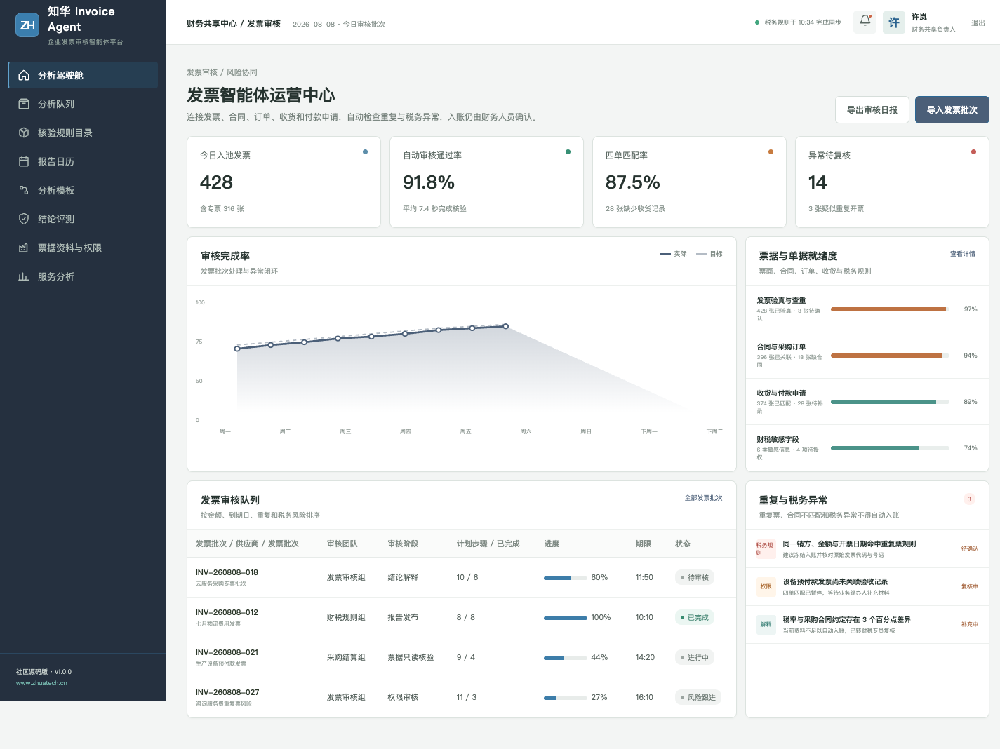
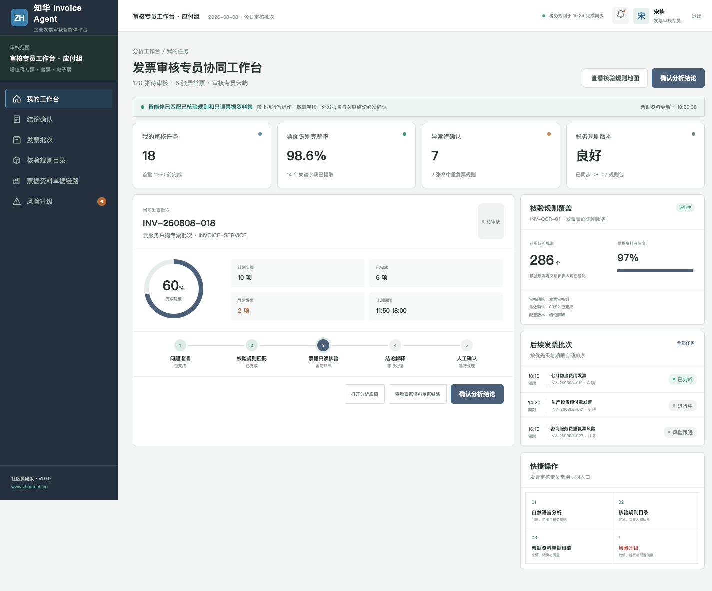

# InvoiceAgent｜企业发票审核智能体社区版

## 本次升级：红字冲销后的净发票与收货匹配

从原发票扣除已确认红字金额，对照已验收金额和已付款金额检查超开或超付；不代替税务发票查验。

新增已认证的结构化录入工作台（`/operations.html`），支持批量核算、逐条结果依据、分级复核和CSV/完整JSON导出。结果由真实后端算法计算，不是预置演示数字。所有数值精确传递，不调用外部模型。

这是**只读核算**：不写库、不审批、不自动执行财务、签署、销毁或设备控制。输入条件满足不是执行授权。[算法、输入边界与接口说明](docs/OPERATIONS-REVIEW.md)。
## 本次功能更新：发票行金额与税额复核

按每行数量、单价和税率核算税前金额、税额及含税额，再与登记总额核对；明确逐行四舍五入，不替代税务查验。 登录后从「业务计算工具」进入，支持真实后端校验与结果导出。详见[接口、示例与边界说明](docs/AI_BUSINESS_UPGRADE_20261023.md)。本次不改变既有许可及联系方式。

[简体中文](README.md) | [English](README.en.md)

由[知华科技（上海如静知华信息科技有限公司）](https://www.zhuatech.cn/)维护。

InvoiceAgent 将发票识别、重复检查、合同/订单/收货/付款匹配、税务规则和人工复核组织成一套可审计的发票审核工作台。系统提供检查与建议，不代替财务人员作出入账和税务判断。

## 审核闭环

| 环节 | 社区版行为 | 人工责任 |
| --- | --- | --- |
| 票面识别 | 提取代码、号码、金额、税率和销方信息 | 核对原始票据 |
| 重复检查 | 组合字段与历史批次比对 | 确认冲红、重开等例外 |
| 四单匹配 | 关联合同、订单、收货和付款申请 | 判断业务真实性 |
| 税务核验 | 应用可配置规则并提示异常 | 财税人员作出结论 |
| 入账发布 | 生成审核结果草案 | 授权人员确认回写 |

管理端用于观察批次效率、异常分布和规则健康度；审核端聚焦当前发票、关联单据、风险证据及处理意见。

## 功能与工程实现

- 发票批次、供应商和到期时间管理
- OCR 结果结构化展示与人工校验
- 重复票、合同不匹配、税率异常提示
- 异常分派、复核、处理结果和审计记录
- Java 21 + Spring Boot + JWT + JPA 后端
- Vue 3 + Pinia + Vite 响应式前端
- MySQL 8 + Flyway，H2 自动化测试
- Docker Compose、Nginx、CI 与完整工程文档

领域规则位于 `InvoiceAuditService`，其决策路径和风险分数可测试、可解释。默认 Agent 运行时不会上传发票、调用第三方 OCR、访问税务系统或连接真实财务数据库。

## 快速体验

~~~bash
cd frontend
npm install
npm run dev:demo
~~~

浏览器打开 `http://localhost:5173`。管理端：`planner / Demo@2026`；审核端：`operator / Demo@2026`。

## 非商业许可

本工程**仅限个人学习、研究和非商业技术交流，不得商用**。企业内部使用、生产部署、财务系统集成、SaaS、收费服务、项目交付、二次销售或品牌替换，必须取得上海如静知华信息科技有限公司书面授权，详情参见 [LICENSE](LICENSE)。

商业授权、财务系统定制、私有化部署、AI 落地和软件外包，可访问[知华科技官网](https://www.zhuatech.cn/)或扫描下方微信二维码。

| 方案咨询 | 项目合作 |
| --- | --- |
|  |  |

SEO：发票审核 Agent、智能发票管理、四单匹配、财务共享中心、Java Vue MySQL、企业 AI 转型、知华科技。

## 2026 企业级热度项目升级

本次根据公开仓库访问热度补充 **发票三单匹配与异常挂账**：对采购订单、收货记录和发票金额执行容差匹配，并处理重复票、税务异常和财务复核。

- 企业 API：`POST /api/enterprise/invoice/three-way-match`
- 决策输出：执行许可、量化指标、阻断/升级路线、控制清单
- 可审计性：规则确定、输入输出可留痕，并附正常与阻断场景测试
- AI 接入：预留 DeepSeek-compatible 建议层配置，AI 不直接绕过审批或改变正式业务状态

详细设计见 [企业级升级说明](docs/ENTERPRISE_UPGRADE.md)。深度开发、企业部署和系统集成请联系[知华科技（上海如静知华信息科技有限公司）](https://www.zhuatech.cn/)。

## 企业付款放行与反舞弊

`POST /api/enterprise/invoice/payment-release` 在付款批次生成前校验发票真实性、三单匹配、重复风险、供应商和税务状态、制裁筛查、银行账户变更、争议止付、预算、审批人数与职责分离，并生成可去重的付款指纹。详见[付款放行说明](docs/ENTERPRISE_PAYMENT_RELEASE.md)。

## 重复发票与账户变更识别

`POST /api/enterprise/invoice/duplicate-risk` 对发票号码、供应商税号、金额和日期窗口执行精确与近似重复检查，同时识别未经回拨确认的收款账户变更，输出 `CLEAR / REVIEW / BLOCK` 和关联历史票据。

## 输入对照与版本化快照

在既有「红字冲销后的净发票与收货匹配」基础上，新增 `/comparison.html`：基准与候选两组数据都由当前真实算法重算，按编号展示新增、移除、逐字段变化和精确数值差，支持筛选、分页和全量导出。原核算入口可导出输入快照，对照页经后端完整校验后整体导入；失败不覆盖当前输入。

快照区分项目、字段契约及算法版本。建议较宽松不代表风险已下降，输入摘要不是签名；操作人和时间仅为响应元数据，不是持久化审计。本次未新增模型调用或业务写入，也不代表全系统生产认证。详见[输入对照操作与接口说明](docs/INPUT-COMPARISON.md)。
